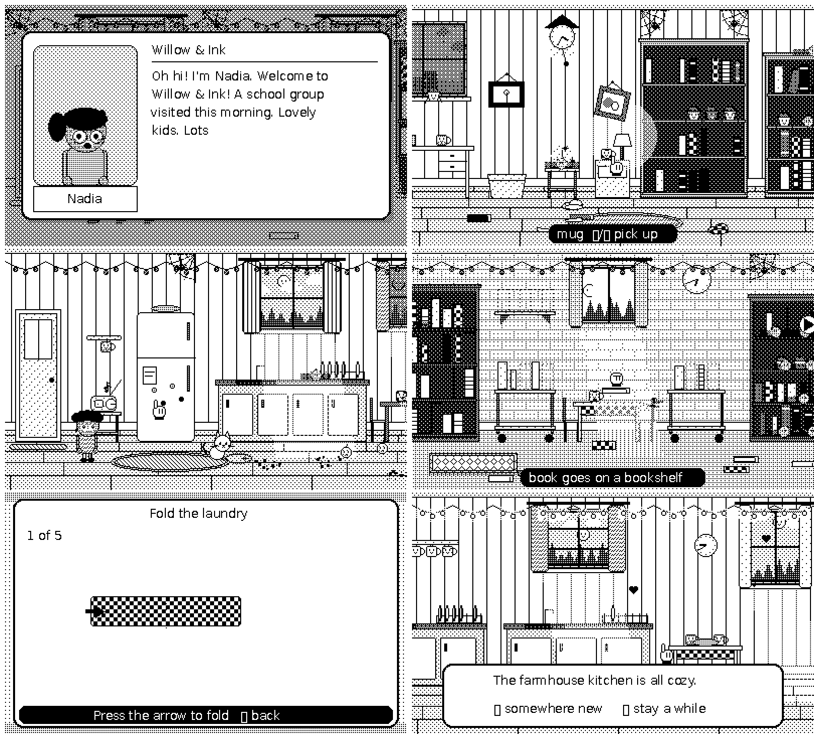

# Tidy Nook 🧽

A cozy, unhurried Playdate game about tidying little places.


No score. No timer. Just you, a crank, some soft lofi and a room that slowly gets cozier.

It's cute, too: chibi people with rosy cheeks, kittens and puppies to pet, dust bunnies with little eyes, and mugs, jars, plant pots and pastries that look a bit lost on the floor and smile once they're back where they belong.

Every place is procedurally generated: the furniture, the wallpaper, the view out of the window, the weather, the time of day, what's on the floor, who lives there and what they're like. You never tidy the same room twice.

## Places

Bedroom · Bookshop · Apartment · Kitchenette · Cafe · Record Shop · Plant Shop · Art Studio · Bathroom · Cabin · Laundromat

Each has its own furniture, things to put away, kinds of mess and little extras (a shop cat, a coffee grinder, a turntable, a fireplace...).

## Controls

| | |
|---|---|
| ✛ D-pad | Move your hand around the room (it scrolls) |
| 🎣 Crank | **Grab**: turn to close your hand on something, turn again to put it down where it belongs. **Scrub** stains, **wipe** windows and mirrors, **sweep** crumbs and leaves, **water** plants, **wind** clocks, **tune** the radio, **pet** the cat |
| 🎤 Microphone | **Blow** gently to puff away dust and cobwebs near your hand |
| Ⓐ | Pick up / put down, open close-ups, chat with people. Hold Ⓐ to crank without the crank |
| Ⓑ | Peek at what still needs a little care. In close-ups: step back |

### Close-ups (d-pad tasks)

- **Straighten a crooked picture**: tilt with ◀ ▶ (or the crank) until the bubble level is centred.
- **Make the bed**: ⬆ pull up the blanket, ◀ ▶ smooth the wrinkles, Ⓐ fluff the pillows.
- **Fold laundry**: press the arrow for each fold. Shirts, sweaters, towels, trousers, scarves.
- **Sort a shelf**: books and jars by height, records from A to Z.

### Little joys (no task, just nice)

Crank the radio or turntable to change the music. Pet the cat or dog until they purr. Wind a music box and it plays a tune in the song's key. Grind coffee in the cafe. Switch lamps on. When a place is all cozy, the string lights come on and you can **stay a while**. There's also **Just relax** on the title screen: a tidy room, rain on the window and music.

## The music

All sound is synthesized live on the Playdate. There are no audio files. Lofi research pointed to a fairly consistent recipe, and the generator follows it:

- **Slow tempo**: lofi sits around 70–90 BPM. The game picks 64–90 depending on your tempo setting and slows down at night.
- **Jazzy chords**: maj7, m7, m9, add9, 6/9 and sus voicings over classic progressions (ii–V–I–vi, IV–iii–ii–I, I–IV–I–iv...), voice-led in a warm middle register.
- **Lazy swing** (~55–60%) and slightly late, soft, muffled drums.
- **Warmth and wear**: a low-pass "tape" filter, a slow pitch wobble (wow), and vinyl crackle.
- **Masking ambience**: soft filtered-noise rain (close to the pink noise many people find calming), a crackling fireplace, birdsong, wind or cafe clinks, chosen to match the weather and place.

A new song is generated for every place, with a fresh key, progression, groove and wandering pentatonic melody. Styles: **lofi beats**, **mellow lofi** (no drums), **rainy piano**, **music box** and **late-night jazz**.

## Settings

Music style, music/ambience/effects volume, tempo, ambience type, vinyl crackle, tape wobble, chatty voices · hand speed, crank feel, how far to turn to grab, dusting (blow / crank / both), mic sensitivity, hold-Ⓐ-to-crank · room size, messiness, weather, time of day (including your real clock), visitors, pets, playful pets · hints (full / gentle / none), hint bar, text speed, sparkle amount, night screen (inverted).

Your room is saved when you leave, so **Continue** picks up exactly where you were. Finished places become postcards in **Memories**.

## Install

Every push that touches `playdate/` builds the game on GitHub Actions and publishes **TidyNook.pdx.zip** under [Releases](https://github.com/WarmFridge/WarmFridge.github.io/releases).

- **On a Playdate:** upload the zip at <https://play.date/account/sideload/>, then on the device go to Settings › Games.
- **In the Simulator:** unzip and drag `TidyNook.pdx` onto the Playdate Simulator.

Build it yourself with the [Playdate SDK](https://play.date/dev/):

```sh
cd playdate/TidyNook
pdc source TidyNook.pdx
```

## Testing without a Playdate

`tools/` holds a strict mock of the Playdate Lua API so the whole game runs headless in plain Lua 5.4:

```sh
cd playdate/TidyNook
lua5.4 tools/smoketest.lua            # visits every menu, then a bot tidies one of every place, saving and resuming midway
lua5.4 tools/screenshots.lua /tmp/s   # records draw calls for a set of screens...
python3 tools/render_log.py /tmp/s/21_bookstore_1.log out.png   # ...and renders them to PNG
```

The mock rejects nil/NaN drawing arguments, bad patterns, out-of-range note volumes and anything that wouldn't survive the datastore's JSON.

## Code map

| | |
|---|---|
| `source/main.lua` | Boot, scenes, system menu, saving on sleep/quit |
| `source/game/play.lua` | The room: hand, crank, mic, placing things, camera, the ending |
| `source/game/focus.lua` | D-pad close-ups (level, bed, fold, sort) |
| `source/game/spots.lua`, `fixtures.lua`, `agents.lua` | Messes, interactive things, people and pets |
| `source/gen/` | Themes, procedural rooms, people and their dialogue |
| `source/art/` | Everything is drawn with code: furniture, items, walls, windows, people |
| `source/audio/audio.lua` | Generative lofi, ambience and sound effects |
